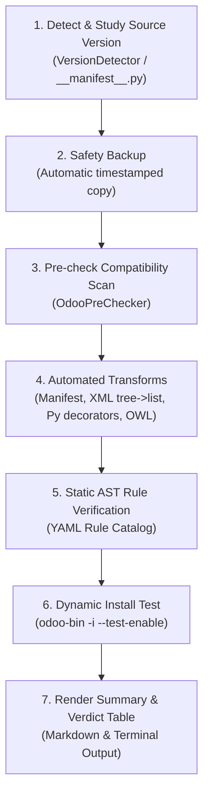

# Master Odoo Upgrade Assistant (`/upgrade-odoo`)

This skill orchestrates the end-to-end upgrade of Odoo custom modules across major versions (e.g., 18 → 19 or 19 → 20).

## Chained Upgrade Pipeline

When invoked with a target directory (e.g., `/upgrade-odoo /path/to/addons`):



---

## Autonomous Agent Instructions

Follow these execution steps strictly:

### Step 1: Detect and Study the Target Addons
1. Inspect the provided directory:
   - Read all `__manifest__.py` files.
   - Note the declared version series (`14.0`, `16.0`, `17.0`, `18.0`, etc.).
   - Identify module dependencies (`depends`), model definitions, views, and frontend assets.
2. If the user specifies a target version (e.g., 19 or 20), adopt it. Otherwise, default to target `19`.

### Step 2: Run the Upgrade & Live Installation Engine
Execute the upgrade CLI pipeline:
```bash
odoo-upgrader <path_to_addons> --target <target_version>
```
*(Or with explicit DB: `odoo-upgrader <path_to_addons> --target <target_version> --db <db_name>`)*

**Dynamic App Installation Verification:**
The tool automatically detects the system's `odoo-bin` and PostgreSQL environment, and will attempt to install each upgraded custom module with:
`odoo-bin -d <db> -i <module> --stop-after-init --no-http`
to verify that the server does not crash and no view/model validation errors occur.

### Step 3: Handle Complex Failures & Edge Cases
If the static checker reports blockers or the live install test fails:
1. **Traceback Analysis:** Inspect the traceback reported in `./upgrade_reports/` or the console.
2. **Consult Reference Guides:**
   - **Views & UI (`tree` vs `list`, XPath, `invisible`):** Check [`skills/odoo-19/references/odoo-19-view-guide.md`](file:///home/muhts/dev/Codes/metamorphosis/odoo-upgrader/skills/odoo-19/references/odoo-19-view-guide.md).
   - **Frontend & OWL Services (`_jsonRpc`):** Check [`skills/odoo-19/references/odoo-19-owl-guide.md`](file:///home/muhts/dev/Codes/metamorphosis/odoo-upgrader/skills/odoo-19/references/odoo-19-owl-guide.md).
   - **Decorators & Constraints:** Check [`skills/odoo-19/references/odoo-19-decorator-guide.md`](file:///home/muhts/dev/Codes/metamorphosis/odoo-upgrader/skills/odoo-19/references/odoo-19-decorator-guide.md).
   - **Known Migration Pitfalls:** Check [`skills/odoo-upgrade/reference/error_catalog.md`](file:///home/muhts/dev/Codes/metamorphosis/odoo-upgrader/skills/odoo-upgrade/reference/error_catalog.md).
3. **Structural Data Retention Strategy:**
   If a legacy module has deeply broken business logic that is no longer needed, apply the [`odoo-structural-data-retention`](file:///home/muhts/dev/Codes/metamorphosis/odoo-upgrader/skills/odoo-structural-data-retention/SKILL.md) pattern:
   - Retain the model and stored field definitions (`store=True`) so historical data remains intact.
   - Comment out obsolete `@api.onchange`, `create`/`write` overrides, and deprecated action buttons.
   - Upgrade XML views so the historical records can still be viewed and printed.

### Step 4: Present the Final Overview Table
Always summarize the results to the user in a clear Markdown table:

| Module | Source Version | Target Version | Files Modified | Pre-Check | Static Checks | Dynamic Install | Overall Verdict |
| :--- | :---: | :---: | :---: | :---: | :---: | :---: | :---: |
| `custom_crm` | v18 | v19 | XML:3 PY:2 JS:0 | Crit:0 / Tot:2 | Block:0 / Warn:1 | ✅ Pass (3.2s) | ✅ **SUCCESS** |

Include:
- **What Went Right:** Successful transforms, backed-up locations, verified syntax.
- **What Went Wrong & Action Items:** Any remaining warnings, tracebacks, or recommended manual tweaks.
